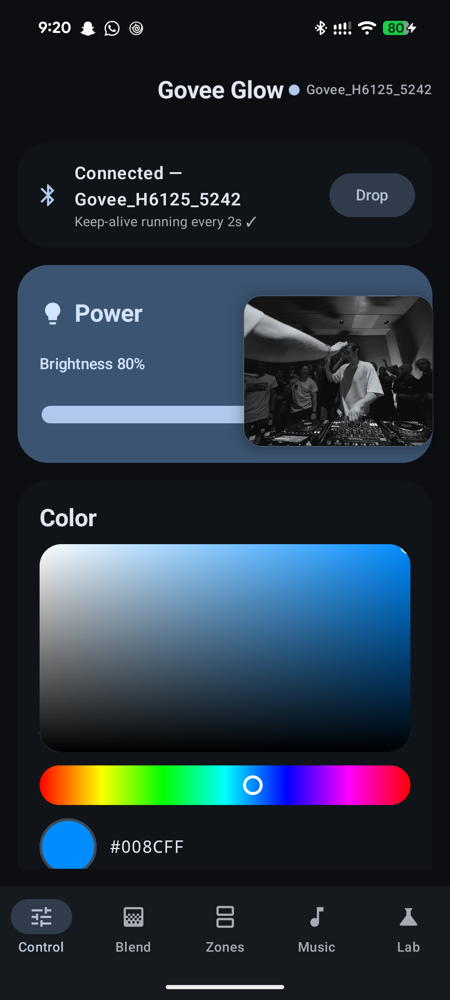
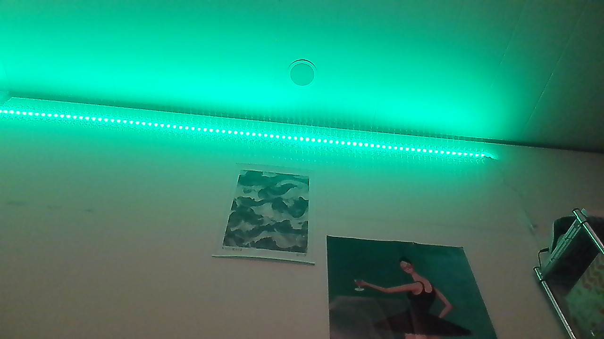
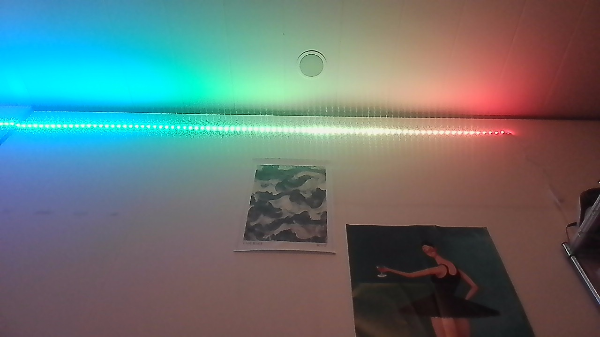

<div align="center">

# Govee Glow

Local Android control for the Govee H6125 Bluetooth LED strip. No account, no cloud, no Govee app.


</div>

| Control tab | Solid color | 15-zone gradient |
|---|---|---|
|  |  |  |

## Features

- Power, brightness, and color control: HSV picker, white temperature slider, hex copy, eight built-in presets, 12 saved colors, and eight recent colors.
- Six gradient presets and a custom two-color blend, with direction flip and a hardware gradient toggle.
- 15-zone RGBIC painting: select any subset of segments, with All, Left, Right, Invert, and None shortcuts.
- Music mode from the strip's own microphone: three profiles measured on the H6125, sensitivity control, and a two-color palette.
- Home screen widgets for power and brightness, a Quick Settings tile, and Android 11+ device controls.
- Schedules by time and weekday (on, off, dim, or color) plus sunset and sunrise rules with offsets. Both are computed on the phone and restored after reboot.
- Lab tab with a BLE scanner, auto-link settings, a raw 20-byte packet sender with automatic XOR, and a packet log.

## Install

Download `govee-glow-v1.3.apk` from [Releases](https://github.com/hectoragofi/govee-glow/releases) and sideload it. Requires Android 8.0 or newer and a BLE-capable phone.

To build from source, open the project in Android Studio (AGP 8.9.2, JDK 17, compileSdk 36) and run it on a physical device. Emulators cannot do BLE.

Close the official Govee app before connecting. Bluetooth-only strips accept one connection at a time.

## Device support

Tested on an H6125 only (15-zone RGBIC, Bluetooth only). Other Govee BLE controllers use different services, frame layouts, scene IDs, and music profile bytes. The legacy solid-color frame `33 05 02 RR GG BB` is included for basic H61xx strips, but it has not been tested on one here.

## Protocol

Service `00010203-0405-0607-0809-0a0b0c0d1910`, write characteristic `00010203-0405-0607-0809-0a0b0c0d2b11` (WRITE_NO_RESPONSE), notify characteristic `00010203-0405-0607-0809-0a0b0c0d2b10`.

Every command is 20 bytes. Bytes 0-18 carry the payload padded with zeros; byte 19 is the XOR of the first 19. The strip drops an idle connection after about 10 seconds, so the app sends `aa 01 00 ... 00 ab` every 2 seconds.

The table shows the meaningful payload bytes. Pad to 19 bytes with zeros and append the checksum before sending.

| Action | Frame |
|---|---|
| Power on / off | `33 01 01` / `33 01 00` |
| Brightness 0-100 | `33 04 <percent>` |
| Solid color | `33 05 15 01 RR GG BB 00 00 00 00 00 FF 7F` |
| Per-segment color | `33 05 15 01 RR GG BB 00 00 00 00 00 <left> <right>` |
| Music palette | `a3 00 01 02 41 <profile> <count> <RGB...>`, then `a3 ff <RGB...>`; send each fragment twice |
| Music start | `33 05 13 <profile> <sensitivity 0-99>` |
| Music stop | any solid color frame |
| Hardware gradient | `33 a3 01` / `33 a3 00` |
| Scene | `33 05 04 <scene id>` |

Some details differ from the commonly published layouts for this family:

- The segment mask lives at bytes 12 and 13, not 8 and 9. Bytes 8-11 must be zero. The left byte covers segments 1-8; the right byte covers 9-15. This layout was found by testing ten candidate frames against the strip.
- Music starts with `33 05 13`, not `33 05 0c`. The profiles measured on this unit are `03` Rhythm (strong), `05` Pulse (medium), and `33` Flow (gentle). Profile IDs can differ between devices.

Scene IDs in the app come from H6199 research. Some work on the H6125 and some do not; the Lab tab is there to try them.

The Kotlin implementation is in [GoveeProtocol.kt](app/src/main/java/com/example/goveecontroller/ble/GoveeProtocol.kt) and has no dependencies outside the Kotlin standard library.

## Tools

The `tools/` folder contains the Python scripts used to check frames against hardware. They talk to the strip over BLE directly and do not use the app.

| Script | Purpose |
|---|---|
| `test_govee.py` | Scan, then send power, color, and brightness frames. |
| `fuzz_govee.py` | Send candidate color frames while you watch the strip. |
| `auto_fuzz.py` | Webcam loop that detects when a candidate frame changes the strip. |
| `verify_gradient.py` | Paint single segments and a 15-zone rainbow, saving photos. |
| `verify_music.py` | Beep at the strip, sample webcam frames, and compare music profiles. |

```bash
pip install bleak opencv-python numpy
python tools/test_govee.py --scan
```

The camera scripts open the webcam with `CAP_DSHOW`, so they are written for Windows. `verify_music.py` also uses `winsound` and will not run on macOS or Linux without changes.

## How the protocol was checked

The starting point was public reverse-engineering work for other Govee strips: coding.kiwi H6054, Obi2000 H6199, egold555 H6113, allepet H6125, chvolkmann's `govee_btled`, and paulo's music-mode writeup. Unknown bytes were settled by sending frames from a PC and pointing a webcam at the strip: color candidates, segment masks, music profiles, and gradient writes. The scripts in `tools/` are the same ones used for those tests, so the checks can be repeated on another unit.

## Notes and limits

- The app targets the H6125. Do not expect it to work unchanged on other models.
- Schedules need the "Alarms & reminders" permission on Android 12+ for exact timing.
- Sunset and sunrise rules need a one-time location capture; the calculation runs locally.
- Dynamic color needs Android 12+. Older versions get a fixed theme.

## Credits

Protocol research by the projects listed above. Test strip: H6125_5242, which sat through roughly 200 frames.

## License

MIT. See [LICENSE](LICENSE).

Not affiliated with Govee. This is clean-room interoperability work; no Govee app code, assets, or keys are included.
